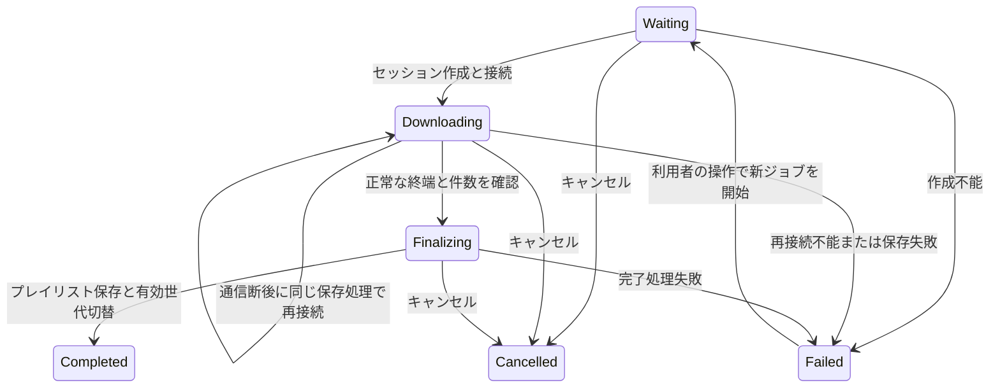

# オフライン保存の自動再接続と先頭からの再試行

外出先の低速回線で通常のオフライン保存が切断されたとき、同じエンコード結果を短時間だけサーバーのRAMに保持し、端末への保存が確定した次のセグメントから自動再接続する。再開できなければ失敗を表示し、オフライン保存一覧から同じ画質で先頭から保存し直せるようにする。

設計基準は2026年11月13日の upstream/master `3c4a7cb6b51534a9d94d392f25be2d3524fce35a`。作業ブランチは `feat/offline-ram-retry` とし、旧 `feat/offline-download-resume` のコミットを取り込まず、この基準から実装する。本書の数値は実装・計測を始めるための暫定値である。

## 要件と範囲

- エンコード後の映像をサーバーのファイル・DB・外部キャッシュへ保存しない。既存のログや入力キーフレーム情報の更新は従来どおりとする。
- 自動再接続は、同じページの通常Fetch保存処理が存続している間を対象とする。アプリ内の画面遷移は継続可能だが、ページの再読み込み・終了・サーバー再起動を越える途中再開は対象外とする。
- 通信が復旧すれば保存済み区間を再送せず、端末への保存が未確定の範囲を取り直す。FetchやOSが先読みした未保存のセグメントもこの範囲に含む。同一セッション内でも別のエンコーダー実行結果を継ぎ足さない。
- 再開不能時に全量の再保存を自動開始しない。利用者が一覧の「最初から保存し直す」を押した場合だけ、新しい保存を開始する。
- 既存の保存済み動画は、新しい動画の保存が完全に成功するまで保持する。
- Background Fetchは従来の単一リクエスト方式を維持し、失敗後の手動先頭再試行を追加する。通常Fetch用の自動再接続は適用しない。
- 新しい依存パッケージ、サーバー設定、DBテーブル、IndexedDBのストア・永続的な再開情報は追加しない。旧PRの未公開データ形式への移行機構も追加しない。

Ownerは、SSDへの中間映像保存を避けるRAM再接続案の検討と、一覧からの先頭再試行に前向きな意向を示している。[PR #297 の追加返信](https://github.com/tsukumijima/KonomiTV/pull/297#issuecomment-6696101122)

## 最新masterから変更する点

| 現在の処理 | 新しい通常保存の処理 |
| --- | --- |
| `VideoOfflineStreamAPI` がHTTP要求ごとに新しい `VideoStream` を作る | RAMセッションの作成と、同一セッションへの接続を分ける |
| HTTP終了時にエンコーダーとセッションを破棄する | HTTP応答だけを終了し、短い再接続猶予を設ける |
| `getSegment()` が取得済みセグメントを10個程度保持する | 端末の保存完了通知を基準に解放し、未送信分も容量制限する |
| `finalizeResponse()` が例外時に即失敗・断片削除する | 通信障害だけを接続の再試行へ返し、最終失敗時に断片を回収する |
| 失敗ジョブの主な操作が一覧からの削除 | 同じ画質・保存方式で先頭からやり直す操作を追加する |

参照箇所は `server/app/routers/VideoStreamsRouter.py`、`server/app/streams/VideoStream.py`、`server/app/streams/VideoEncodingTask.py`、`client/src/services/OfflineVideos.ts`、`client/src/services/OfflineVideoStorage.ts`。

## 端末の保存完了通知

サーバーの送信完了は、CacheStorageへの保存完了を意味しない。そこで、クライアントは連続して保存できた範囲の次の番号 `next_sequence` を通知する。この通知をACKと呼ぶ。

1. セグメントを最後まで読み、番号・長さ・durationを検証する。
2. 現在の保存世代のCacheStorageへ `cache.put()` する。
3. ジョブがまだ実行中であることを既存の `updateActiveJob()` で確認する。
4. 実行中の保存処理のRAMにある `next_sequence`、duration一覧、確定済み容量を同期的に進める。
5. 最新のACKをサーバーへ送る。ACK送信前に次のセグメントを受信してもよい。

ACKは最大3秒間隔でまとめ、同じ値の再送を許可する。再接続GETにも確定位置を含め、ACK要求やその応答が失われても回復できるようにする。CacheStorage・IndexedDBの失敗ではACKを進めず、保存失敗として終了する。

確定位置をIndexedDBへ新しく永続化する必要はない。同じ保存処理内の再接続ではRAMを使い、ページが終了した場合は既存の `recoverInterruptedForegroundDownloads()` が失敗を確定して未完了の世代を回収する。

## API

新しいリソースの基底パスを次とする。

`/api/streams/video/{video_id}/{quality}/offline-sessions/{session_id}`

`session_id` はクライアントが保存開始前に作る128bitランダム値の32桁hex文字列。サーバーは別の128bitランダム値 `generation_token` を作り、作成応答のJSON本文で返す。取得後の要求では専用ヘッダー `X-KonomiTV-Offline-Generation` に載せる。ログイン用Authorizationヘッダーとは分け、トークンをURLやログへ出さない。

| 操作 | 要求と応答 |
| --- | --- |
| `PUT` 基底パス | RAMセッションを冪等に作成。新規201、同じ条件の再要求200。録画情報・画質・protocol_version=2・generation_tokenをJSONで返す |
| `GET` 基底パス | `next_sequence` と単調増加する `connection_id` をクエリで指定。既存の同一世代だけに接続し、フレーム化したストリームを返す |
| `PUT` 基底パス`/checkpoint` | JSONの `next_sequence` と `connection_id` を検証しACKを更新。200で現在の確定位置を返す |
| `DELETE` 基底パス | 完了・キャンセル・最終失敗時の終了処理。204。存在しない場合も204、存在する別世代のトークンでは409 |

### 初回作成と接続

- 作成は録画の状態と画質を検証してRAMへ登録するだけとし、最初のGETでエンコーダーの実行枠取得を開始する。GETは実行枠の取得完了を待たずにHTTPヘッダーとメタデータを返し、待機中もkeepaliveとcheckpoint要求を処理する。
- 録画ID、ファイルhash・サイズ・更新時刻、追加オプションを含む画質をセッションに保持する。初回GETでは実ファイルのサイズとhashをDBと照合し、その時点のファイル識別情報を記録する。内容が同じなら録画スキャンがDBの更新日時を更新しないため、初回はDBとの更新日時の差だけで拒否しない。以後のGETと正常終端の公開前には、記録した実ファイルの識別情報・DB情報を照合し、変更を検出した場合は409で再開不能とする。各GETでは要求画質も照合する。本文開始後に判明した場合は正常終端を送らず終了する。変換設定は起動中の `Config()` を使い、設定変更の反映に必要なサーバー再起動ではRAMセッションも失われるため、現在の変換設定との再照合は行わない。
- 初回PUTの応答を失った場合だけ、同じ `session_id` でPUTを再送する。並行PUTは同じ登録にまとめる。既存登録と指定条件が違えば409。
- PUT応答を受け取った後の再接続はGETだけを使う。消えたセッションをGETで再作成せず、410を返す。期限後のPUTで新しい世代が作られても、旧トークンで接続できない。
- RAMセッションは最大3件とし、作成のみ・変換待ち・変換中・再接続待ち・完了確認待ちをすべて数える。枠が埋まった場合は429と待機秒数を返す。最初の作成前はクライアントの `Waiting` として約5秒間隔で待機し、キャンセルできる。サーバー側に無制限の作成待ち登録を置かない。
- エンコーダーの実行枠は既存の3枠をBackground Fetchと共有する。RAMセッションの上限とは別に管理し、変換終了時に実行枠を一度だけ返す。最終データの確認待ちもRAMセッション数には含む。
- PUT応答を受け取る前のキャンセルで残り得るのは短命のRAM登録だけ。期限で回収する。キャンセル後にPUT応答が届いた場合は、そのトークンでDELETEしてGETを開始しない。

### 接続の引き継ぎとACKの検証

セッションごとに、保存確認済みの `acked_next`、クライアントへ提示した `offered_next`、生成済みの `produced_next` を持つ。GETの開始位置は `acked_next <= next_sequence <= offered_next <= produced_next` の範囲に限り、ACKを同時に進める。必要なデータが保持されていなければ410とする。

`offered_next` はセグメント本文を送信処理へ渡す直前に更新する。端末が保存しACKを返す時点でASGIのsend完了後処理がまだ動いていない競合を許容する。未来の番号をACKする要求は拒否し、遅れて到着した小さいACKは値を戻さない。

再接続時に旧HTTPが半開きで残っていても、新しい `connection_id` で旧応答だけを中断して引き継ぐ。エンコーダーは継続する。古い接続番号のGETは409とし、遅れて到着した旧GETが新接続を奪わないようにする。ACKは現接続の番号を照合し、旧ACKで期限や接続状態を更新しない。旧応答のfinallyも接続番号を照合してから切断状態を更新する。

### ストリーム形式

新APIでは既存の `KTVODLP\n`、長さ付きJSON、セグメントの `sequence / duration_ms / byte_length / payload` を利用し、メタデータでprotocol_version=2を明示する。メタデータには録画情報・画質・session_id・generation_token・開始位置を含め、作成応答と照合する。

- セグメント番号は0からの連続番号とする。
- `0xfffffffe` と値0の32bit整数2個、計8バイトをkeepaliveレコードとして予約する。セグメント生成・実行枠・正常終端前の照合の待機中も10秒間隔で送る。セグメントのヘッダー・本文の途中には挿入しない。
- `0xffffffff` と実際の最終セグメント件数の32bit整数2個を終端レコードとする。再接続位置が最終件数と等しい場合は終端だけを再送できる。
- JSONは既存どおり最大1MiB、セグメントはprotocol_version=2で最大32MiBに固定する。範囲外の長さ、未知のレコード、番号の飛び、異なる録画・画質・世代は明示的に失敗させる。
- 仮想プレイリストの予定件数を、完成品の固定件数としてプロトコルへ埋め込まない。正常に生成できた連続セグメント数を終端で確定し、クライアントの確定件数と比較する。

旧 `GET .../offline-stream` の形式はBackground Fetchと既存クライアント向けに維持する。新API未対応を通信断と誤認して再接続したり、途中で旧APIの全量保存へ切り替えたりしない。新しい通常保存には対応するサーバー・クライアントの組を用いる。

## RAMの上限とエンコーダーの制御

| 項目 | 暫定値 |
| --- | ---: |
| RAMセッション数 | 3 |
| 確定済みTSの保持予算 | 64MiB / セッション |
| 生成中の単一セグメント | 最大32MiB |
| `bytearray` から `bytes` への変換時の追加コピー余裕 | 最大32MiB |
| 上記TS本体の合計 | 最大128MiB / セッション、最大384MiB / 3件 |

これは必要に応じて使用するTS本体の予算であり、開始時に全量を確保するものではない。Python・パーサー・ASGI・OSパイプ・エンコーダー・GPUを含む全メモリ使用量の上限ではない。実装時には別途RSSとGPU使用量を計測する。

RAMセッションは確定した `bytes` と再生時間を直接保持し、同じ本体を再送にも使う。解放はACKと送信中の参照数で判断する。

- 次のセグメント生成前に、最大32MiBの確定データを追加できる枠と変換時の余裕を確保する。確定後は実サイズで計上し、予約の余りを返す。
- 未ACKの確定データを保持し、`VideoEncodingTask` は次のセグメントを生成できる容量が空くまでstdoutの読み取りを待つ。
- 読み取りを止めて上流のパイプにも待機を伝える。stderrの監視とキャンセル通知の処理は継続する。同期ロックや同期I/Oをイベントループへ持ち込まない。
- ACK後も送信中の応答が本体を参照している場合は、参照が消えるまで予算に含める。保持中のTS・生成中の配列・変換時コピーを管理する。
- 単一セグメントが32MiBを超える場合は、上限を超える追加前に失敗させる。セグメント途中で容量待ちするとACK可能な完成品がなく停止し続けるため、この場合は待機しない。
- 新経路ではstdoutの読み取り待ちだけに10秒のタイムアウトを掛け、容量待ちやDB保存の時間は除外する。通常再生とBackground Fetchの読み取りには、このタイムアウトを追加しない。
- キャンセル・期限切れ・shutdown・エンコーダー失敗では容量待ちも解除する。プロセスをkillするだけで待機タスクを残さない。

保持容量を超えたデータを一時ファイルへ逃がす経路は設けない。正常時もACK通信とメモリ管理は追加されるため、追加負担ゼロとは表現せず、保存時間・CPU・メモリをmasterと比較する。

## 期限と無通信の検出

| 項目 | 暫定値と意味 |
| --- | --- |
| サーバーのlease期限 | 最後の有効なクライアント通知から90秒 |
| 保存確定ACK | 進捗があれば最大3秒間隔で集約 |
| クライアントの生存通知 | 保存確定がなくても10秒間隔で同じACKを送る |
| ストリームのkeepalive | セグメント間の待機中に10秒間隔 |
| クライアントの無受信検出 | 読み取り待ちで30秒間、本文のバイトもkeepaliveも来なければ接続を中断 |
| PUT作成・GETの接続とHTTPヘッダー待ち | 1要求につき30秒 |
| checkpoint・DELETEの要求期限 | それぞれ10秒・5秒 |

RAMセッションの寿命管理は `OfflineVideoSession` に統一し、最終終了時に `VideoStream.destroy()` を呼ぶ。新経路の `VideoStream` は既存の10秒自動破棄タイマーを無効にし、`getSegment()` などが呼ぶ `keepAlive()` でもタイマーを再設定しない。

leaseを延長できるのは世代・接続番号が正しいクライアントのGETまたはcheckpoint要求だけとする。サーバー自身の `VideoStream.keepAlive()` や、エンコード・送信だけでは延長しない。再接続時は有効な通知により期限を更新する。

保存確定ACKが進むことと、生存通知が届くことを区別する。1セグメントの正常な受信が90秒を超える低速回線でも、同じACKによる生存通知で継続できる。ページ凍結・回線断で通知が止まれば90秒で失効し、回収を開始する。ACKの送信は一度に1要求とし、要求にもタイムアウトを設けて永久に待たせない。

90秒は、生存通知の間隔10秒、無受信の検出30秒、検出後の再接続開始予算45秒に余裕を加えた値である。サーバー再起動などで早く410になる場合は、その時点で自動再接続を終了する。

再接続GETが成功しても旧ACK要求が止まったままにならないよう、接続単位の制御要求も中断して新接続番号で再開する。サーバー側でACK応答を返す前に値を適用し、応答だけ失われても同じ位置を再送できるようにする。ACKの通信エラーは最新の確定位置を保持して次の送信機会に再送し、本文が正常な間は即座に失敗や本文の再接続にしない。401・403・410や現世代の不一致は即座に最終失敗へ進める。

keepaliveがあるため、長いエンコード待ちを通信断と区別できる。ただし、keepaliveだけで実際のエンコーダー異常を隠さず、変換側の失敗をセッションへ伝える。容量待ちと正常な実行枠待ちは異常と扱わない。

## クライアントの状態と再接続

公開するジョブ状態は既存の `Waiting / Downloading / Finalizing / Completed / Failed / Cancelled` を維持する。再接続表示はサービスの実行中contextから取得し、IndexedDBへ新しい状態やフィールドを保存しない。contextの変更も既存の `eventTarget` で通知し、画面遷移後の一覧でも現在の状態を読み取れるようにする。

通常Fetchの外側に再接続ループを置き、同じ `job_id`、保存世代、Web Lock、キャンセル所有権を最後まで保持する。セグメントの確定位置・duration一覧・確定容量・セッション情報も同じRAM contextを共有する。公開の手動 `retry()` をループ内から呼ばない。

`finalizeResponse()` は受信・検証と終端後の完成処理を分け、再接続可能な途中終了でジョブをFailedにしない。Background Fetch側の入口は既存の `finalizeResponse(jobID, response)` を維持し、従来どおり呼び出し元が失敗を確定する。古い接続のreader終了と保存中の処理の決着を待ってから次の接続を開始し、同じ保存世代への書き込みを並行させない。

### 保存開始前の付随データ取得

初回保存と手動の先頭再試行では、サムネイル・局ロゴの取得にも次の制御を適用する。通常Fetch・Background Fetchの準備処理に共通とする。

- 新ジョブの登録前にジョブ単位の `AbortController` を管理対象へ登録し、一覧へ表示された時点からキャンセルできるようにする。ジョブ登録に失敗した場合はcontrollerを回収する。Background Fetchへの登録前も、ジョブのキャンセルで準備中の要求を中断する。
- 各要求をジョブのキャンセルに連動させる。Fetch の応答をそのまま `cache.put()` に渡し、本文の読み取り中もキャンセルを維持する。低速回線での画像取得は従来どおり完了まで待つ。
- 付随画像の通信エラー・画像の書き込み失敗は警告ログを残して動画本体の保存へ進む。利用者のキャンセルは準備処理全体を終了させる。保存先の初期化、IndexedDB、動画本体の保存に失敗した場合は後述のエラー分類に従う。
- 準備中のキャンセル・失敗では、controller・開始用のWeb Lock・前景保存用のWeb Lockを `finally` で回収する。準備完了後は保存方式に応じてキャンセルの所有権を引き渡す。キャンセル後に完了した付随データの `cache.put()` も、未完了世代の回収対象に含める。

### 再接続の予算

- 待機時間は1、2、4、8、15秒を基本とし、前後20%のばらつきを付ける。同じ確定位置から最大5回とする。
- 最初に通信障害を検出してから45秒以内に開始できる再接続だけを行う。回復後に正常に流れている低速受信を45秒で打ち切らない。
- 新しいセグメントが端末に保存確定したときだけ、その位置の回数と期限をリセットする。HTTP 200、メタデータ、keepalive、部分的な受信だけではリセットしない。
- 番組全体に短い期限や総再接続回数の制限を設けない。進捗のない同じ位置での無限再接続を止める。
- `navigator.onLine` は補助情報にとどめ、接続成功の判定にしない。待機と要求は利用者のキャンセルで即解除できるようにする。

### エラーの分類

| 分類 | 扱い |
| --- | --- |
| fetch/bodyの通信エラー、終端前のEOF、無受信タイムアウト、408・502・503・504 | 残り予算内で同一セッションへ再接続 |
| 初回作成の429 | `Waiting` で枠が空くのを待つ。サーバーの待機指示を尊重 |
| 再接続の429 | 残り予算内で待機。初回作成へ戻さない |
| 410、世代・録画・画質の不一致、変換失敗、セグメント上限超過 | 再開不能として最終失敗 |
| 不正なmagic・レコード・番号・終端件数、401・403・404、プログラムの例外 | 明示的に失敗。通信エラーとして握りつぶさない |
| CacheStorageまたはIndexedDBの失敗 | 保存失敗。通信を再試行しない |
| 利用者のキャンセル | Cancelled。接続単位のタイムアウトによるAbortと区別 |

構造化したサーバーエラーのcodeを判別し、HTTP 500を無条件に再接続しない。応答開始後のエンコーダー失敗は正常終端を送らず接続を終了し、続くGETで410として扱えるようにする。古い接続番号に対する応答は現contextと照合し、既に終了したattemptの結果で現ジョブを変更しない。

進捗は「確定済み容量＋現在受信している未確定分」で算出し、再送バイトを累積しない。通常Fetchの再接続時は確定値へ戻せるよう、画面側でも進捗の巻き戻しを許可する。Background Fetchは受信完了後の展開中も表示済みの進捗を維持する。新しいジョブでは必ず表示を初期化する。

## 終了条件とデータ保護

正常な終端を公開できる条件は、入力の読み取りが本来の末尾まで完了し、エンコーダー出力が正常EOFに達し、エンコーダーが正常終了し、タイムアウト・キャンセル・パーサー異常がないこととする。最終セグメントの確定はその条件を検証した後に行う。

`VideoEncodingTask` は新経路の出力を正常EOFまで読み、最後のランダムアクセスフレームと実出力時刻に基づき末尾区間を確定する。入力のフィードも末尾到達を確認し、MP4では `psisimux -p` が示す出力サイズと開始位置から、tsreadexへ渡すべきバイト数を検証する。入力を最後まで送れていない早期終了は、終了コードが0でも失敗とする。出力公開後にエンコーダーを再起動する場合は、そのセッションを失敗で終了する。

クライアントは正常終端と連続件数を確認してから `Finalizing` へ進み、playlistを保存し、既存の `completeJob()` によって有効な保存世代を切り替える。その後にサーバーへDELETEする。終端を送っただけでサーバーのRAMを捨てず、終端喪失からの再接続も受け付ける。完了後のDELETEが失敗しても端末のCompletedは取り消さず、サーバーのlease期限で回収する。

通信断・接続の引き継ぎでは、当該HTTP応答と接続単位のタスク・参照だけを終了させる。応答開始時やsend中の通信例外も同じ扱いとし、変換処理・実行枠待ち・取得済みの実行枠・未ACKデータは `OfflineVideoSession` が保持してlease期限内の再接続を受け付ける。

完了時のDELETE・キャンセル・最終失敗・期限切れ・shutdownでは、接続、ACK、再接続待ち、容量待ち、実行枠待ちをすべて終了させる。サーバー側のプロセス、メモリ、実行枠は `OfflineVideoSession` が一度だけ解放する。HTTP応答の開始前後にかかわらず最終終了時はこの後処理を実行し、`BackgroundTask` だけに依存しない。

録画ファイルの探索・フィードは、読み取りを行うワーカーが入力ファイルの開閉を所有する。入力I/Oが停止しても、子プロセス・RAMセッション・実行枠の回収は読み取りの復帰を待たない。パイプの登録と回収は、入力I/Oが使うasyncioの既定プールから分離してAnyIOのワーカーで行う。停止しているワーカーのファイルは読み取りの復帰後に閉じる。

端末側ではキャンセル後に完了した遅い `cache.put()` も回収する。有効な保存済み動画の世代は削除しない。通常Fetchの最終失敗では未完了の世代を削除してジョブ表示を残すため、失敗後の操作は先頭からの再試行だけとなる。

## 一覧からの先頭再試行

失敗した保存には「最初から保存し直す」と「一覧から削除」を表示する。自動再接続中は「通信が途切れました。再接続しています。」と表示し、キャンセル操作を残す。エラーにRAM・ACK・セッションIDなどの実装用語を出さない。

再試行時は最新の番組情報を取得し、失敗ジョブの画質と保存方式を引き継ぎ、新しいジョブID・保存世代・セッションIDで始める。失敗ジョブがまだ対象であることの確認と新ジョブ登録を同じIndexedDBトランザクションで行い、二重クリックや別タブの競合を防ぐ。`withVideoStartLock()` と既存の保存完了時の世代切替を利用する。

削除は操作列の右端の赤色アイコンとし、Vuetifyの確認ダイアログを使用する。対象ジョブを開いた時点で固定し、表示更新で別ジョブへ操作しない。既存の保存済み動画を残すことが分かる文言にする。画面の変更は `mixin.scss` の全画面サイズで確認する。

## 実装の分割

1. **一覧からの先頭再試行**：クライアントの再試行操作、失敗ジョブのclaim、保存開始前の付随データ取得のキャンセル、削除確認、保存済み動画の保護。通常Fetch・Background Fetchの両方を確認する。
2. **サーバーのRAMセッション**：新API、ACK、同一変換結果の保持、容量待ち、正常EOF、期限・終了処理。サーバーだけで再接続と上限を検証する。
3. **通常Fetchの自動再接続**：RAM context、parserの責任分離、ACK、生存通知、再接続予算、進捗・UI。新APIを利用する。
4. **実通信条件の検証**：低速回線、iOS、Windows/Linux、各エンコーダーで測定し、暫定値と文言を確定する。

APIを追加して利用する変更はサーバーのコミットを先、クライアントを後にする。旧PRを丸ごとcherry-pickせず、必要な不具合修正も最新master上で再確認して取り込む。

主な変更先は次の範囲に限定する。

| 場所 | 責務 |
| --- | --- |
| `server/app/streams/OfflineVideoSession.py` 新規 | RAMセッションの所有権・ACK・容量・期限・接続引き継ぎ |
| `server/app/routers/VideoStreamsRouter.py`、`schemas.py` | 新APIとフレーム形式、既存配信経路との実行枠共有 |
| `server/app/streams/VideoStream.py`、`VideoEncodingTask.py` | 新経路だけの生成抑制・同一実行保証・正常終端 |
| `server/app/app.py` | shutdown時のセッション回収 |
| `client/src/services/OfflineVideos.ts`、`OfflineVideoStorage.ts` | 同一ジョブの自動再接続、手動再試行、既存世代の保護 |
| `client/src/components/Videos/RecordedProgram.vue`、`RecordedProgramList.vue`、`views/OfflineVideos.vue` | 再試行イベントと状態表示、確認ダイアログ |

## 受け入れ条件

- 付随画像の受信が30秒を超えても完了まで待ち、画像を保存してから動画本体の保存を開始できる。通常Fetch・Background Fetchの双方で確認する。
- 付随データ取得中の通信停止からキャンセルすると、開始用と前景保存用のWeb Lockが解放され、同じ番組の次の保存を開始できる。キャンセル後に完了した付随データの保存も回収される。
- 初回PUTの応答喪失・同時PUT・GET冒頭切断でも、同じ保存のエンコーダーが重複起動しない。
- セグメント途中、保存直後、ACK送信・応答喪失、終端喪失から、同じバイト列と連続番号で完成できる。応答ヘッダー送信時・本文send中の通信例外でもセッションを保持し、保存済み区間は再送しない。
- 旧HTTPが半開きでも引き継げる。古いGET・ACK・finally・readerの終了が新接続を壊さない。
- 未ACKのTS・送信中の参照・生成中配列・一時コピーを含めて予算内に収まる。待機解除後も同じエンコーダーが続く。
- 1セグメントの受信に90秒以上かかっても正常に継続できる。容量待ち・実行枠待ちを10秒のエンコード異常や30秒の通信断と誤判定しない。
- 同じ確定位置では5回を超える、または最初の通信障害検出から45秒を過ぎた新しいattemptを開始しない。確立済み接続は別の無受信タイムアウトで判定し、正常な低速受信を45秒で打ち切らない。200やkeepaliveだけで予算が復活しない。
- 10秒を超える通信断でも、クライアントの再接続予算内かつ90秒のlease期限内なら同じセッションへ再接続できる。有効なクライアント通知が90秒途絶えた場合は回収する。
- 期限切れ・サーバー再起動・入力差し替え・エンコーダー異常では、別の出力を追記せず失敗から手動再試行へ移る。
- キャンセル、最終失敗、shutdownがあらゆる待機を解除し、RAM・プロセス・実行枠を回収する。
- CacheStorage・IndexedDBエラーを通信障害として繰り返さず、キャンセル後の遅い保存も回収する。
- 手動再試行、複数タブ、ページ再読み込みを通して、既存の保存済み動画が新保存の成功まで残る。
- 異常EOF、末尾境界、TS・MP4・最新masterで追加されたM2TS、QSVのDTS wrapを検証する。通常の録画再生・シークとBackground Fetchの既存動作も維持する。
- 実際の低速・高遅延・瞬断を組み合わせたiOSで、画面消灯・アプリ切替・復帰を確認する。サーバーへの中間TS書き込みがないこと、正常保存時の時間と資源使用量を測定する。

サーバーの検証は既存方針に合わせE2Eを中心とし、解析の境界だけを小さなテストにする。実データのDBを変更せず、リポジトリのfixtureとテスト用の設定を使う。実装後はサーバーのlint、クライアントのlint・型チェック、全画面サイズのUI確認を行う。

再試行対象の削除競合は、`client/` で `BROWSER_PATH` にChrome・Chromium・Edgeの実行ファイルを指定し、`yarn test:browser` で検証する。専用の一時プロファイルで実IndexedDBとCacheStorageを使い、番組情報取得中に失敗ジョブを削除した場合、新しいジョブを登録せず既存の保存済み動画を維持することを確認する。
